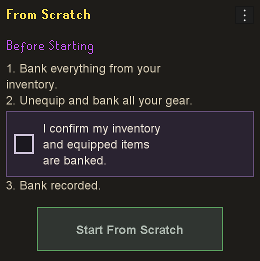
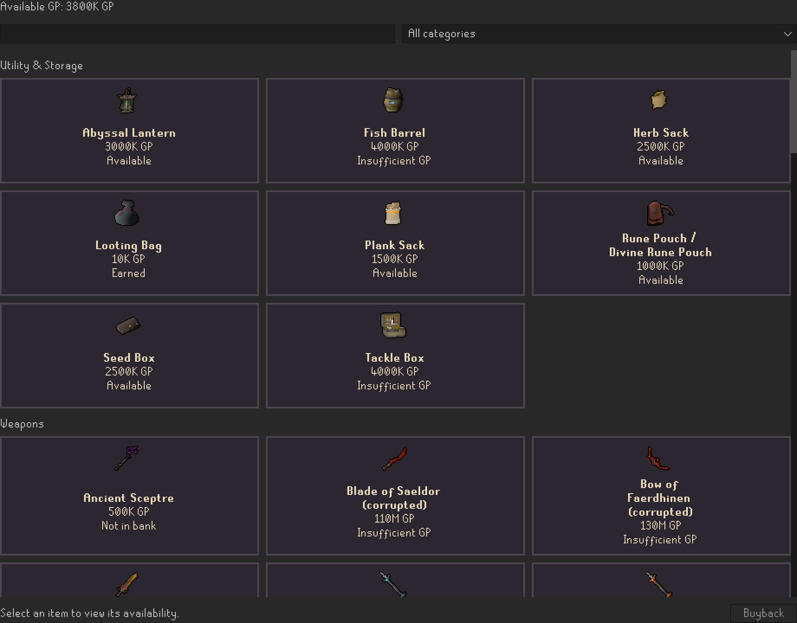

# From Scratch

**A fresh start without a fresh account.**

*Actual sidebar interface with synthetic example progress, not a live RuneScape screenshot.*

From Scratch is independently developed by Pilots r kwl and is not affiliated with or endorsed by Jagex or RuneLite.

**Author: Pilots r kwl**

You've spent years building your Old School RuneScape account. Your bank is packed with equipment, supplies and wealth, but sometimes you want the excitement of starting over without making another character.

From Scratch lets you do exactly that. Keep your levels, quests, achievements, account unlocks and every item you've already earned. When you begin a challenge, your existing bank becomes your **legacy collection**: the items remain physically yours, but you set them aside under the challenge rules.

Start gathering supplies and earning equipment again as if your bank were empty. Rebuild your wealth, work toward new goals, and reclaim certain difficult-to-reacquire legacy items through virtual GP buybacks. Play alone or alongside friends running their own challenges, and reset whenever you want another fresh start.

**Your account stays the same. Your item progression starts over.**

From Scratch tracks your progress; you choose to follow the rules. It does not prevent withdrawals or stop you using legacy equipment, and it does not turn your character into an Ironman.

## Your challenge in three steps

1. **Keep your character.** Retain all levels, quests, achievements and account unlocks.
2. **Start with zero items.** Your starting bank becomes legacy gear. Everything stays yours, but those items are considered unavailable for the challenge.
3. **Earn everything again.** Play normally, bank newly earned items, track your challenge ownership and build toward your next upgrade.

Start another run at any time with **Reset Progress**. Your real items and account are untouched.

## Installation

From Scratch is distributed through RuneLite Plugin Hub. **Availability is temporarily paused pending review.** RuneLite disabled distribution with the reason "disallowed readme"; see the [review status](docs/LAUNCH.md#current-status).

Once RuneLite restores availability:

1. Open RuneLite.
2. Open **Plugin Hub** from the configuration panel.
3. Search for **From Scratch**.
4. Select **Install**.
5. Open the purple coin sidebar and follow the plugin's **Before Starting** setup instructions.

[Installation and legacy progression migration guidance](docs/INSTALLATION.md)

## See your fresh start grow

The gallery shows actual plugin panels rendered with **synthetic example data**. These are interface previews, not live RuneScape screenshots or personal progression.

**Prepare your challenge**

*Setup explains what to bank and asks you to confirm before starting. The overview above follows your bank value, GP, unlocks and Time Played.*

**Reclaim useful legacy gear**

*Browse tile-based buybacks and check prices and availability. Open an image for a closer view.*

**Follow your progress and trades**

| Bank progression | Grand Exchange purchases |
|---|---|
|  |  |
| Review deposits, withdrawals and accounted legacy contents. | Review observed trades, including completed partial purchases. |

See [individual item history](docs/media/item-history.png), [GE sales](docs/media/ge-sales.png) and [all interface previews](docs/SCREENSHOTS.md) for more examples.

Genuine gameplay captures are still needed for Virtual Bank filtering, gray physical and signed virtual quantities, and RuneLite's plugin-options panel. The [capture checklist](docs/SCREENSHOTS.md#owner-gameplay-capture-checklist) describes the safe owner captures; these views are not fabricated here.

## Build a bank worth using again

- **Find your available gear.** Virtual Bank filters to item types with positive challenge ownership while keeping native bank tabs and search. Turn off **Enable Virtual Bank View** to see your full bank.
- **Know what you can use.** Bright virtual counts show your challenge balance; gray counts show the physical stack. Shading identifies unavailable legacy items. Outstanding legacy withdrawals appear as signed debt until you return or replace them.
- **Set your next goal.** Follow bank value, available virtual GP, unlocked items, Peak Progress Value and Time Played in the sidebar. Item values are estimates; time counts play on this computer.
- **Review your journey.** Browse bank and item history, inspect exact quantities with normal Examine, and review completed Grand Exchange purchases and sales observed while the plugin is running.
- **Keep useful storage.** Supported Potion Storage uses dose-based progress. Rune Pouches, Looting Bags and other supported containers have safeguards so a buyback does not also unlock old contents.
- **Keep your run.** Progress saves locally for each character. Export a private backup, import it for the same character, or reset when you want a fresh challenge.

For example, your physical bank might contain 110 sharks while only 10 belong to the challenge. Both counts remain visible. You decide to withdraw the earned 10; normal banking still allows you to withdraw the whole stack.

[How to play](docs/GAMEPLAY.md) · [Detailed features and limits](docs/FEATURES.md)

## Reclaim your legacy equipment

Save virtual GP for **Legacy Buybacks** and give familiar gear a new place on your goal list. Browse alphabetized **Utility & Storage**, **Weapons**, **Armour** and **Skilling Outfits**, then review the price before confirming a purchase.

| Goal | Fixed virtual GP cost |
| --- | ---: |
| Fire Cape | 1,000,000 |
| Rune Pouch / Divine Rune Pouch family | 1,000,000 once |
| Looting Bag family | 10,000 once |
| One selected Black Mask / Slayer Helmet copy | 1,000,000 |
| Carpenter, Pyromancer, Raiments of the Eye, Smiths' Uniform or Zealot complete set | 2,000,000 each |

The catalog also includes corrupted crystal weapons, Emberlight, crystal armour, imbued rings, Dizana's Quiver and gathering containers. Full outfits require every qualifying piece, and copy limits still apply.

These are fixed gameplay costs paid with **virtual GP**. Buybacks leave real coins and equipment untouched. Equipment earned normally during the challenge is available without a buyback, and a storage unlock never includes its legacy contents.

[All fixed prices and supported variants](docs/technical/BUYBACK_PRICING.md)

## Your adventure, alone or alongside friends

From Scratch is a solo challenge you can also share with friends. Start on the same day, compare virtual bank values, race to earn a particular weapon, or set milestones for your next boss trip. Agree on your goals and celebrate each other's progress.

Each player keeps their own progression locally. There is no shared bank, automatic multiplayer synchronization or integrated leaderboard. Compare progress yourselves, and keep account details and private saves out of shared screenshots.

## FAQ

**Does it delete my bank or change my account?**

No. Your real items, levels, quests, achievements and account unlocks stay yours. From Scratch tracks a separate challenge balance.

**Does it stop me using legacy gear?**

No. This is a voluntary game mode. The plugin distinguishes legacy items from earned challenge ownership, but normal withdrawal and equipment controls remain available.

**How do I earn challenge items and GP?**

Play normally and bank what you earn. From Scratch updates your challenge balances from bank changes. Available virtual GP is your challenge coin balance after committed buyback spending. See [the gameplay guide](docs/GAMEPLAY.md) for examples.

**Can I use the Grand Exchange?**

Yes. Normal buying and selling are part of the challenge. Completed trades the plugin observes are shown in its history.

**Can I play on mobile or another computer?**

The next bank observation on your usual computer reconciles the net bank change, but cannot reconstruct every unseen transaction or mobile playtime. Use private Export / Import Progress when moving your main run between computers; there is no automatic sync.

**Can I start over?**

Yes. **Reset Progress** ends the current run after confirmation and keeps a recovery archive. Export a private backup first if you want your own copy. Your actual items remain untouched.

## Privacy and safety

Progress stays on your computer. From Scratch has no account registration, cloud progression or analytics service, and it does not ask for passwords or tokens. It uses RuneLite's public item prices without uploading your holdings. Saves and exports are private and unencrypted, so keep them safe and never attach them to a public issue.

[Data and privacy](docs/DATA_AND_PRIVACY.md) · [Safe troubleshooting and bug reports](docs/TROUBLESHOOTING.md)

## Support and documentation

[Report a bug or request a feature](https://github.com/PilotsRKwl/fromScratch/issues/new/choose) · [Gameplay](docs/GAMEPLAY.md) · [Installation](docs/INSTALLATION.md) · [Feature reference](docs/FEATURES.md) · [Documentation](docs/README.md) · [Contributing](CONTRIBUTING.md)

Created by **Pilots r kwl**. [BSD 2-Clause license](LICENSE) · [Artwork credits](docs/ARTWORK.md) · [Plugin Hub reviewer guide](docs/PLUGIN_HUB_REVIEW.md)

RuneScape and Old School RuneScape are trademarks of Jagex Ltd. Item artwork belongs to Jagex. From Scratch is an independent community project with no Jagex or RuneLite affiliation.
